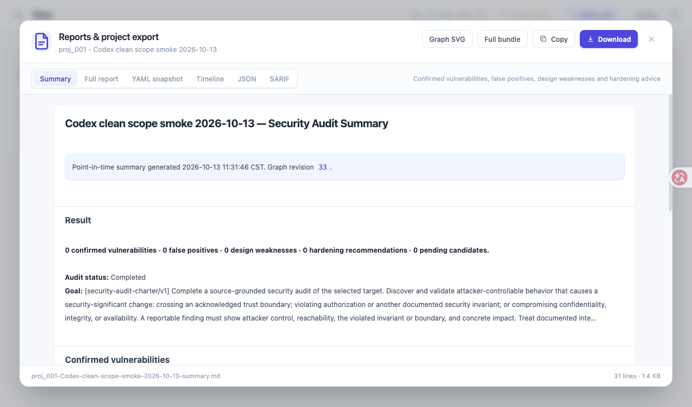
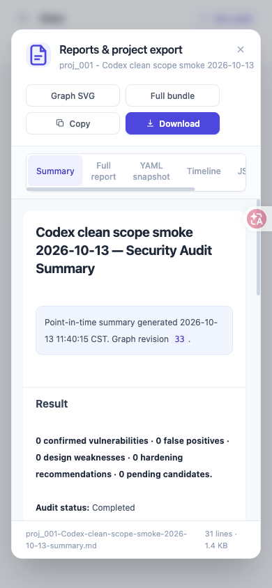

# Codex CLI 审计链路验证（2026-10-13）

本次验证使用真实 Codex CLI 0.156.1、可用模型 `gpt-6-sol` 和独立本地样例数据库。
模型输出未用预设答案替代。下面是三个有界样例的结果，不是大规模漏洞基准或任意项目的成功率承诺。
运行说明见 [CODEX-AUDIT.md](CODEX-AUDIT.md)。

## 完成结果

| 样例 | 最终状态 | 运行记录 | 确认漏洞 | 图版本 |
| --- | --- | --- | --- | --- |
| 参数绑定的安全 SQLite 查询 | completed，完成门禁通过 | 9 成功 | 0 | 33 |
| 同一安全源码，独立重新运行 | completed，完成门禁通过 | 10 成功 | 0 | 33 |
| 拼接 SQL 的本地库函数 | completed，完成门禁通过 | 34 成功、1 取消 | 1 | 90 |

每个样例均生成 Markdown 报告、摘要、SVG 证据图、JSON 快照、SARIF 和含 SHA-256 的 ZIP。
三个包分别校验了项目标题、状态、图版本、确认数量及所有文件的散列和大小。
正向样例包含 27 个事实、33 个任务和 8 个复核节点；SARIF 保留原候选与确认结果两条不同语义的记录，不应据此计为两个漏洞。

## 真实运行发现并修复的问题

- Docker 内 Codex 的嵌套 bubblewrap 无法创建命名空间，导致文字健康检查通过但源文件读取失败。容器内改用已有 Docker 隔离边界，保留只读挂载、非 root、能力删除和资源限制；主机 CLI 仍使用只读策略。随机内容读取探针实际通过。
- Recon 配置分析可生成互相矛盾的枚举组合。原生输出 schema 现在表达这些组合约束，语义校验继续保留；实际 Codex schema 探针通过。第二次安全样例中，修复前的一次不一致输出由已有 resume 修复路径成功恢复。
- 静态和动态证明均通过后，调度器没有提交技术确认。现在调用服务端原子确认接口，服务端重新检查证据、动态回执及可报告性。
- 已确认结果被当作需要再次评估的新候选。现在沿当前代次的合法 promotion 边读取原候选评估；新的相反评估仍会阻止完成。
- 不同输入下成功生成的旧摘要被计入失败重试预算，阻止新确认结果进入报告。重试计数现在按本次输入计算。
- 增加离线 SVG 和一致性 ZIP 导出；摘要保留当前代次、当前计划的最新覆盖结论和缺口。图布局支持证明环、复核关系和孤立节点，文本按 XML 规则转义。

## 正向样例的恢复过程与范围

正向样例首次运行时未配置动态执行器，因此保留为未确认候选。随后为该本地样例注册了操作者提供的 oracle：在离线容器内调用冻结源码中的库函数，用普通输入和注入输入分别运行。正向输入返回样例私有值，负向输入仅返回普通用户行；两个回执均经真实 Codex 独立复核。

恢复沿用原数据库、源码快照和历史运行记录，没有重置审计预算。过程中取消了一次正在运行的 reason 调用，并在修复调度/完成逻辑后重启服务。首次 promotion 通过修复后的 dispatcher 方法执行，服务端门禁照常生效；随后正常调度生成新摘要并完成。初次停滞与恢复记录均被保留，不能把这次运行描述为从头到尾无干预成功。

动态结果只证明该本地库函数的行为。源码没有可执行的外部调用端，部署可达性仍是报告中的限制。报告保留早期 Recon 的缺口及证明原子的独立评估状态；它们不是额外漏洞，也不表示未检查的类别已经安全。

## 验证命令

```bash
uv run --project linen --group dev pytest linen/linen/tests
# 778 passed, 6 skipped
LINEN_ORACLE_DOCKER_E2E=1 uv run --project linen --group dev pytest linen/linen/tests/test_oracle_docker_e2e.py -q
# 3 passed（实际离线 Docker 正负对照；不是 LLM 审计基准）
uv build --project linen
# wheel 和 sdist 构建通过
```

桌面和 390px 手机视口验证了导出按钮，浏览器下载的包也通过散列检查。





本机忽略的 `dispatch.yaml` 已改为 Codex 单一 worker，并通过实际模型响应健康检查；缺少本地镜像的可选 CodeQL 执行器已关闭。认证信息未写入示例配置或报告。正式目标需要配置自己的动态 oracle，见 [INDEPENDENT-ORACLES.md](INDEPENDENT-ORACLES.md)。

## 本机证据

详细记录在验证机器上被 Git 忽略的 `.linen-runtime/codex-delivery-20261013/`，其中包含源样例、冻结快照、模型执行归档、恢复账本、测试日志和导出校验结果。这些运行归档不随 GitHub 仓库发布；以下路径相对于该本机目录。

- 安全样例导出包：`clean-scope/delivery/audit.zip`
- 重复安全样例导出包：`clean-repeat/delivery/audit.zip`
- 注入样例导出包：`positive-scope/delivery/audit.zip`
- 注入样例摘要：`positive-scope/delivery/summary.md`
- 注入样例证据图：`positive-scope/delivery/graph.svg`

本次验证服务已经停止，工作目录、数据库及归档保留以便复查。
